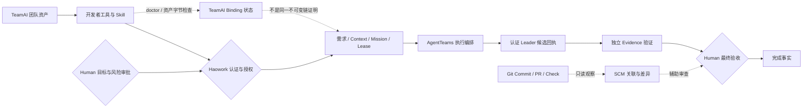
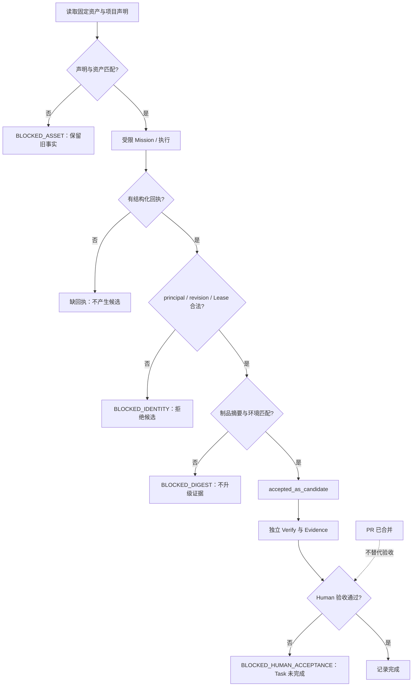

# TeamAI 与 Haowork：事实流和门禁

实线表示受治理的操作或事实写入；虚线表示只读观察；菱形表示人工或服务端门禁。图是目标操作流程，不表示真实系统联调已经完成。当前本地跨模块合同覆盖了同一 Binding/Mission/Assignment/Receipt/Trace 快照的重开回放；真实 TeamAI 双命名空间 E2E 仍为 `NOT_RUN`。

TeamAI rules/agents/skills 不直接修改治理事实，也不授予权限。Human 声明资产绑定；Haowork 校验后追加验证事实。AgentTeams RuntimeBinding 的 revision 与 TeamAI 声明的 team_revision 是不同合同，不应因为字段都叫 revision 就当成同一证据。

Mission 的 `teamai_source` 只能由服务端根据当前项目的 `Ready` binding ID 派生；客户端不提交仓库、revision 或 digest。Assignment 注册时比较完整快照，Receipt Store 和 Trace 在写入前再次比较；任一不一致均失败关闭。旧 Mission/Assignment/Receipt/Trace 没有该字段时保持 `nil`，不被强行升级。

缺回执、错误 principal、错误运行绑定 revision 和摘要错配的本地合同可复现；演示中的 BLOCKED 标签描述阻断层，并非承诺所有 CLI 都输出相同字符串。已落盘候选后发生 Evidence 摘要错配时，保留候选及失败事实，不能抹掉历史；接收阶段校验失败则不产生候选。PR merged 观察不生成 Evidence，也不能旁路 Human 门禁。

正常路径与失败演练见 [演示脚本](teamai-demo-script.md)；产品安装、双仓规则和验证边界见 [集成说明](teamai-integration.md)。
